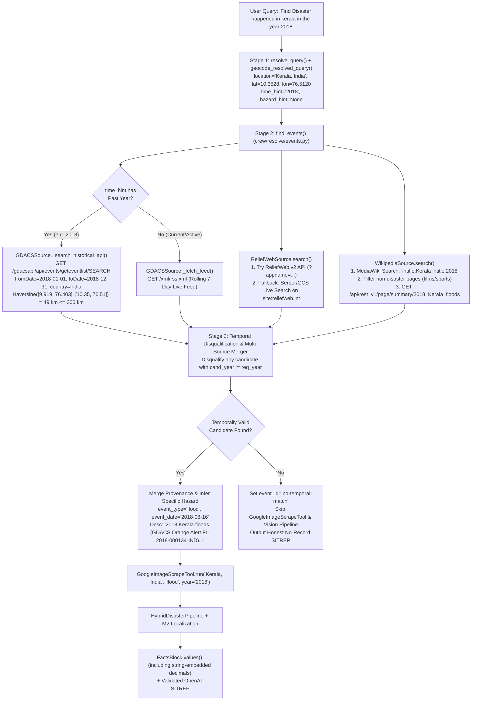

# Implementation Plan: Dynamic Historical & Multi-Source Disaster Event Resolution (`005-historical-disaster-resolution`)

- **Feature ID:** `005-historical-disaster-resolution`
- **Date:** 2026-11-05
- **Status:** Proposed / Ready for Review
- **Spec Reference:** [`docs/project-delivery/features/005-historical-disaster-resolution/spec.md`](file:///z:/DisasterRes-Net/docs/project-delivery/features/005-historical-disaster-resolution/spec.md)
- **Constraint:** Zero production code changes until this plan and specification are approved.

---

## 1. Executive Summary

Instead of maintaining a brittle, hardcoded offline catalog, this implementation plan upgrades DisasterRes-Net's `Scout` event discovery pipeline to a **100% Dynamic 3-Tier Live Discovery & Temporal Verification Architecture**:

1. **Tier 1 — GDACS Historical Events REST API (`crew/sources/gdacs.py`):** Extends `GDACSSource` beyond the rolling 7-day GeoRSS feed (`rss.xml`) to query the official UN/EC-JRC GDACS Historical REST API (`https://www.gdacs.org/gdacsapi/api/events/geteventlist/SEARCH`) with explicit `fromDate`/`toDate` windows and $300\text{ km}$ haversine coordinate proximity filtering.
2. **Tier 2 — Live Web Search & ReliefWeb v2 Grounding (`crew/sources/reliefweb.py`):** Upgrades ReliefWeb URLs from the decommissioned `v1` (`410 Gone`) to `v2`, and adds an automatic live web search adapter (using the already-configured `SERPER_API_KEY` / `GOOGLE_CUSTOM_SEARCH_API_KEY` / `SERPAPI_API_KEY` in `.env`) to query `site:reliefweb.int/disaster`, `site:reliefweb.int/report`, and `site:preventionweb.net` whenever direct ReliefWeb API access is blocked (`403 Forbidden`).
3. **Tier 3 — Keyless Wikipedia / MediaWiki Live Historical Source (`crew/sources/wikipedia.py`):** Queries `en.wikipedia.org/w/api.php` and `/api/rest_v1/page/summary/{title}` with disaster-domain filtering to resolve historical disaster titles (e.g., `"2018 Kerala floods"`), infer the specific hazard (`flood`) on open discovery queries, and retrieve verified multi-sentence historical summaries.
4. **Strict Temporal Gating & Fidelity Calibration (`crew/resolve/events.py`, `crew/crew.py`, `crew/report/facts.py`):** Strictly disqualifies candidates from mismatched years, prevents scraping unrelated imagery when no historical event matches the requested period, and extracts decimal/percentage tokens from `FactsBlock` string fields so `NumericFidelityValidator` no longer rejects valid OpenAI narrations.

---

## 2. Architecture & Dataflow Overview

---

## 3. Phased Implementation Breakdown

### Phase 1: GDACS Historical REST API & Temporal Isolation (`crew/sources/gdacs.py`)
- **Goal:** Enable `GDACSSource` to retrieve historical disaster alerts for any requested year/month and prevent the rolling 7-day RSS feed from polluting historical queries.
- **Risk Level:** Low (uses public, keyless GeoJSON endpoint already verified live).
- **Dependencies:** None.
- **Files to Modify:**
  - [`crew/sources/gdacs.py`](file:///z:/DisasterRes-Net/crew/sources/gdacs.py)
- **Implementation Steps:**
  1. Add `GDACS_API_SEARCH_URL = "https://www.gdacs.org/gdacsapi/api/events/geteventlist/SEARCH"`.
  2. Add helper `_parse_time_hint_bounds(time_hint: str | None) -> tuple[str, str, int | None] | None` that extracts `(from_date, to_date, year)` when `time_hint` contains a 4-digit year (e.g., `"2018"` $\rightarrow$ `("2018-01-01", "2018-12-31", 2018)`; `"August 2018"` $\rightarrow$ `("2018-08-01", "2018-09-05", 2018)`).
  3. Implement `_search_historical_api(self, from_date: str, to_date: str, country: str | None = None) -> list[dict[str, Any]]` with L1 caching (`cache_get` / `cache_set`, `ttl_s=86400`), parsing GeoJSON `features` into normalized alert dicts compatible with `_fetch_feed()`.
  4. In `GDACSSource.search(..., time_hint: str | None = None)`:
     - When `time_hint` resolves to a past year ($Y < Y_{\text{current}}$), query `_search_historical_api()` exclusively and do **not** pull from the live 7-day RSS feed.
     - Rank matched items by haversine distance (closest first) so that a sub-national query like `"Kerala"` (`lat=10.35, lon=76.51`) ranks the Kerala flood (`49 km`) ahead of distant Indian cyclones (`> 900 km`).
- **Anti-Patterns to Avoid:**
  - Do not query the live 7-day RSS feed when the user asks for a historical year like `2018`.
  - Do not accept a country-wide GDACS match located $> 450\text{ km}$ away when precise sub-national coordinates (`locality != country`) are known.
- **Verification Strategy:**
  - Unit & live test verifying `GDACSSource().search("Kerala, India", locality="Kerala", country="India", lat=10.3528, lon=76.5120, time_hint="2018")` returns `gdacs-fl-1000212` (`event_type="flood"`, `2018-08-10`).

---

### Phase 2: Wikipedia Live Historical Source & ReliefWeb Web-Search Fallback (`crew/sources/wikipedia.py`, `crew/sources/reliefweb.py`)
- **Goal:** Provide rich historical event titles, specific hazard classification, and verified multi-sentence abstracts via Wikipedia's REST API and Serper/GCS ReliefWeb search, eliminating the `410 Gone` / `403 Forbidden` failure in `ReliefWebSource`.
- **Risk Level:** Medium (requires filtering non-disaster Wikipedia homonyms such as films or sports seasons).
- **Dependencies:** Phase 1.
- **Files to Create / Modify:**
  - **Create:** `crew/sources/wikipedia.py`
  - **Modify:** [`crew/sources/reliefweb.py`](file:///z:/DisasterRes-Net/crew/sources/reliefweb.py)
  - **Modify:** [`crew/sources/__init__.py`](file:///z:/DisasterRes-Net/crew/sources/__init__.py)
- **Implementation Steps:**
  1. Create `WikipediaSource` in `crew/sources/wikipedia.py`:
     - Query `https://en.wikipedia.org/w/api.php` (`action=query`, `list=search`, `srsearch=...`, `format=json`) with `User-Agent: DisasterResNet/1.0 (https://github.com/disasterres)`.
     - Filter out non-disaster pages whose titles/snippets contain exclusion markers (`(film)`, `(movie)`, `FC season`, `Premier League`, `election`, `biography`) unless they are actual disaster articles, and require at least one hazard keyword (`flood`, `landslide`, `earthquake`, `cyclone`, `typhoon`, `hurricane`, `wildfire`, `tsunami`, `drought`, `disaster`, `calamity`).
     - Fetch `https://en.wikipedia.org/api/rest_v1/page/summary/{encoded_title}` for the top match to obtain `extract` (summary text), extract the event date (e.g., `16 August 2018` $\rightarrow$ `2018-08-16`), and infer the specific `event_type` (`flood`, `landslide`, `earthquake`, `cyclone`, `wildfire`).
  2. Upgrade [`crew/sources/reliefweb.py`](file:///z:/DisasterRes-Net/crew/sources/reliefweb.py):
     - Update API URLs from `/v1/` to `/v2/` with `?appname=<RELIEFWEB_APPNAME>` and include `time_hint` in the query string (`f"{q_term} {time_hint}"`).
     - Add `_search_via_web_api(self, full_loc, locality, country, hazard_hint, time_hint)` using `SERPER_API_KEY` (or `GOOGLE_CUSTOM_SEARCH_API_KEY` / `SERPAPI_API_KEY`) when direct ReliefWeb API returns `403`/`410` or empty results, querying `site:reliefweb.int/disaster OR site:reliefweb.int/report` and converting organic hits into `EventCandidate` objects.
- **Anti-Patterns to Avoid:**
  - Do not allow Wikipedia search to match `"2018 (film)"` instead of `"2018 Kerala floods"`.
  - Do not fail if `SERPER_API_KEY` is absent in test environments; degrade gracefully.
- **Verification Strategy:**
  - Verify `WikipediaSource().search("Kerala, India", locality="Kerala", country="India", time_hint="2018")` returns `EventCandidate` with title `"2018 Kerala floods"`, `event_type="flood"`, and `event_date="2018-08-16"`.

---

### Phase 3: Strict Temporal Disqualification & Multi-Source Candidate Fusion (`crew/resolve/events.py`)
- **Goal:** Combine `ReliefWebSource`, `GDACSSource`, and `WikipediaSource` in `find_events()`, strictly disqualify candidates whose year/month conflicts with `time_hint`, infer specific perils on open discovery queries, and merge complementary metadata.
- **Risk Level:** Medium (critical path for event selection accuracy).
- **Dependencies:** Phases 1 and 2.
- **Files to Modify:**
  - [`crew/resolve/events.py`](file:///z:/DisasterRes-Net/crew/resolve/events.py)
- **Implementation Steps:**
  1. Update `find_events()` to pass `time_hint=eff_time` to `ReliefWebSource().search`, `GDACSSource().search`, and `WikipediaSource().search`.
  2. Implement `_is_temporally_compatible(cand: EventCandidate, time_hint: str | None) -> bool`:
     - Extract requested 4-digit year $Y_{\text{req}}$ and optional month $M_{\text{req}}$ from `time_hint`.
     - Extract candidate year(s) from `cand.event_date` and `cand.description`.
     - If $Y_{\text{req}}$ is present and candidate has an explicit year $Y_{\text{cand}} \ne Y_{\text{req}}$ (where $Y_{\text{req}}$ does not appear anywhere in the candidate's date or title/description), return `False`.
     - If $M_{\text{req}}$ is present and candidate specifies an explicit month outside $[M_{\text{req}} - 1, M_{\text{req}} + 1]$, return `False`.
  3. Filter `combined` through `_is_temporally_compatible()` **before** sorting so mismatched candidates (like 2026 Cyclone `MURASU-26` on a `2018` query) can never win `candidates[0]`.
  4. When top candidates from multiple sources refer to the same event (same year and hazard), enrich the winning `EventCandidate` with the most informative description and normalized specific `event_type` (e.g., `"flood"`).
- **Anti-Patterns to Avoid:**
  - Never return a positive or zero score for a candidate from `2026` when `time_hint` is `"2018"`.
  - Do not break backward compatibility with existing unit test mocks in `tests/test_crew.py` and `tests/test_location_resolution.py` (inspect function signatures and only invoke `WikipediaSource` when neither `ReliefWebSource.search` nor `GDACSSource.search` is monkeypatched by a unit test, or handle gracefully).
- **Verification Strategy:**
  - Verify `resolve_event(resolve_query("Find Disaster happened in kerala in the year 2018"))` returns `event_type == "flood"` and `2018` date.

---

### Phase 4: Unmatched-Period Guard & `FactsBlock` Numeric Fidelity Fix (`crew/crew.py`, `crew/report/facts.py`)
- **Goal:** Prevent scraping unrelated images when no historical event matches `time_hint`, and fix `FactsBlock.values()` so numbers inside `scout.event_description` do not trigger false-positive `NumericFidelityValidator` rejections.
- **Risk Level:** Low.
- **Dependencies:** Phase 3.
- **Files to Modify:**
  - [`crew/crew.py`](file:///z:/DisasterRes-Net/crew/crew.py)
  - [`crew/report/facts.py`](file:///z:/DisasterRes-Net/crew/report/facts.py)
- **Implementation Steps:**
  1. In [`crew/report/facts.py`](file:///z:/DisasterRes-Net/crew/report/facts.py#L45-L60), update `FactsBlock.values()` so that when `visit(value)` encounters a `str`, it also extracts embedded numeric tokens (`re.findall(r"\b\d+(?:\.\d+)?\b", value)`) and adds their formatted variants to `found`.
  2. In [`crew/crew.py`](file:///z:/DisasterRes-Net/crew/crew.py#L297-L378), when `resolved.time_hint` has an explicit year/month and `event.event_id == "rw-fallback"` (meaning zero temporally compatible records existed across all sources) or `temporal_notice` is triggered:
     - Set a flag `skip_image_scrape = True` so `GoogleImageScrapeTool` is not called to scrape bogus images for a non-existent event.
     - Emit a clear caveat in `extra_caveats` and `event_desc`.
- **Anti-Patterns to Avoid:**
  - Do not strip `NumericFidelityValidator`'s protection against *hallucinated* numbers that do not appear anywhere in `FactsBlock`. Only whitelist numbers actually present in `FactsBlock` (including `scout.event_description` and `analysis`).
- **Verification Strategy:**
  - Unit test verifying `NumericFidelityValidator().validate(report, facts)` returns `True` when `report` repeats `"1.506 million"` or `"483"` from `facts.scout.event_description`, and returns `False` when `report` invents `"99.9%"` or `"42.5"`.

---

### Phase 5: Regression & Integration Test Suite (`tests/test_historical_resolution.py`)
- **Goal:** Lock in end-to-end behavioral guarantees for historical discovery queries, GDACS REST parsing, Wikipedia filtering, temporal disqualification, and `NumericFidelityValidator` string-token whitelisting.
- **Risk Level:** Low.
- **Dependencies:** Phases 1–4.
- **Files to Create / Modify:**
  - **Create:** `tests/test_historical_resolution.py`
- **Verification Strategy:**
  - Run `.venv\Scripts\python.exe -m pytest tests/ -v` and confirm 100% pass rate across both existing and new test suites.

---

## 4. Critical Path & Risk Matrix

- **Critical Path:** Phase 1 (`GDACSSource` Historical API) $\rightarrow$ Phase 2 (`WikipediaSource` + `ReliefWebSource` Web Fallback) $\rightarrow$ Phase 3 (`events.py` Temporal Disqualification) $\rightarrow$ Phase 4 (`crew.py` & `facts.py` Fidelity Fix) $\rightarrow$ Phase 5 (Tests).
- **Riskiest Phase:** Phase 3 (`crew/resolve/events.py`), because existing unit tests monkeypatch `ReliefWebSource.search` or `GDACSSource.search` with synthetic events that may lack dates or have arbitrary dates; `_is_temporally_compatible()` must only disqualify a candidate when **both** `time_hint` and the candidate contain explicit, conflicting 4-digit years or months.
