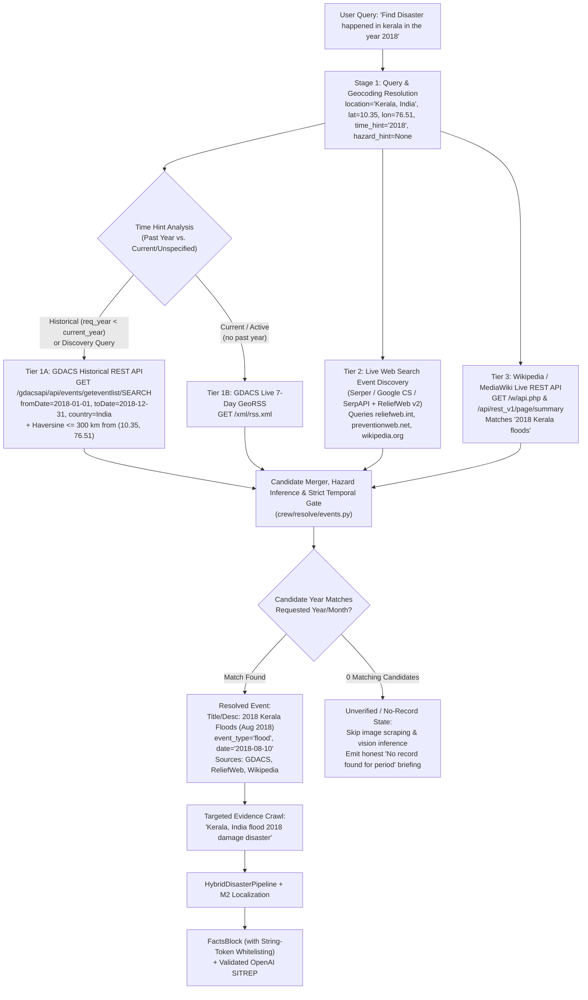

# Functional Specification: Dynamic Historical & Multi-Source Disaster Event Resolution (`005-historical-disaster-resolution`)

**Feature ID:** `005-historical-disaster-resolution`  
**Status:** Ready for Review  
**Date:** 2026-11-05  
**Target Directory:** `docs/project-delivery/features/005-historical-disaster-resolution/`  
**Related Context Docs:**
- [`docs/SYSTEM_ARCHITECTURE_AND_AGENT_WORKFLOW.md`](file:///z:/DisasterRes-Net/docs/SYSTEM_ARCHITECTURE_AND_AGENT_WORKFLOW.md)
- [`docs/project-delivery/features/004-ai-location-resolution/spec.md`](file:///z:/DisasterRes-Net/docs/project-delivery/features/004-ai-location-resolution/spec.md)
- [`crew/sources/gdacs.py`](file:///z:/DisasterRes-Net/crew/sources/gdacs.py)
- [`crew/sources/reliefweb.py`](file:///z:/DisasterRes-Net/crew/sources/reliefweb.py)
- [`crew/resolve/events.py`](file:///z:/DisasterRes-Net/crew/resolve/events.py)
- [`crew/report/facts.py`](file:///z:/DisasterRes-Net/crew/report/facts.py)
- [`crew/report/validator.py`](file:///z:/DisasterRes-Net/crew/report/validator.py)
- [`crew/crew.py`](file:///z:/DisasterRes-Net/crew/crew.py)

---

## 1. Overview

When a user asks an open-ended or historical disaster query—such as *"Find Disaster happened in kerala in the year 2018"*—DisasterRes-Net's `Scout` stage must dynamically discover the authoritative historical event (**2018 Kerala Floods**, August 2018, GLIDE `FL-2018-000134-IND`), infer the specific hazard (`flood`) when the user only says *"disaster"*, retrieve temporally aligned evidence imagery, and generate a grounded situation report (`SITREP`).

Hardcoding an offline dictionary of historical disasters is explicitly rejected as an architectural anti-pattern because it cannot scale to arbitrary global locations, sub-national districts, or any year/month combination. Instead, this specification defines a **100% Dynamic, Live 3-Tier Multi-Source Event Discovery & Temporal Verification Architecture**:

1. **Tier 1 — GDACS Historical Events REST API (`gdacs.org/gdacsapi`) + Live GeoRSS (`rss.xml`):** Queries the public, keyless UN/EC-JRC GDACS REST API (`/api/events/geteventlist/SEARCH`) with explicit `fromDate`/`toDate` bounds and $300\text{ km}$ haversine coordinate filtering for historical queries, while reserving the 7-day rolling GeoRSS feed strictly for active/current-year queries.
2. **Tier 2 — Live Web Search Grounding (`Serper.dev` / `Google Custom Search` / `SerpAPI`):** Uses the search API keys already configured in `.env` to dynamically search ReliefWeb (`site:reliefweb.int/disaster` and `site:reliefweb.int/report`), UNDRR PreventionWeb, and GFDRR when direct ReliefWeb API access is unavailable or rate-limited.
3. **Tier 3 — Wikipedia / MediaWiki Live Search & REST Summary API (`en.wikipedia.org`):** Public, keyless encyclopedia search and summary extraction (`/w/api.php` + `/api/rest_v1/page/summary/{title}`) that resolves major historical disasters, extracts canonical hazard types, and provides verified historical context.
4. **Strict Temporal Disqualification & Numeric Fidelity Alignment:** Disqualifies any event candidate whose year diverges from the user's requested `time_hint`, halts spurious image scraping when no valid record exists for the requested time window, and indexes decimal/percentage tokens inside `FactsBlock` string fields so valid OpenAI narrations are not falsely rejected by `NumericFidelityValidator`.

---

## 2. What Exists Today (Forensic Root-Cause Autopsy)

When the user queried `"Find Disaster happened in kerala in the year 2018"`, the system returned:
- **Selected Event:** `Cyclone | Date: 2026-11-01 | Tropical Cyclone MURASU-26`
- **Overview Notice:** `[CRITICAL NOTICE: No authoritative disaster record was found specifically for 2018 in Kerala, India. The nearest active alert on record occurred from 2026-11-01.]`
- **Narration Mode:** `Mode · deterministic (validation fallback)`

Six concrete code defects caused this failure:

1. **ReliefWeb API v1 Decommission (`HTTP 410 Gone`) & Unregistered v2 `appname` (`HTTP 403 Forbidden`):**
   - [`crew/sources/reliefweb.py`](file:///z:/DisasterRes-Net/crew/sources/reliefweb.py#L55-L56) hardcodes `https://api.reliefweb.int/v1/disasters` and `https://api.reliefweb.int/v1/reports`.
   - UN OCHA permanently decommissioned API `v1` (`410 Gone`). Meanwhile, `v2` (`https://api.reliefweb.int/v2/disasters`) enforces a strict pre-approved `appname` whitelist (`403 Forbidden: You are not using an approved appname`).
   - Because `ReliefWebSource.search()` catches `(httpx.HTTPError, ...)` and silently continues, **ReliefWeb currently returns `[]` for 100% of queries**.
   - Even if `v1` were still alive, `ReliefWebSource.search()` hardcoded `"preset": "latest", "limit": 5` without passing `time_hint` to the query or filter payload, meaning it could only ever fetch the 5 most recent events.

2. **`GDACSSource` Only Queries the Rolling 7-Day Live RSS Feed:**
   - [`crew/sources/gdacs.py`](file:///z:/DisasterRes-Net/crew/sources/gdacs.py#L124) only fetches `https://www.gdacs.org/xml/rss.xml`, which exclusively lists alerts from the last 7 days.
   - It never calls the official GDACS Historical REST API (`https://www.gdacs.org/gdacsapi/api/events/geteventlist/SEARCH`), which contains historical alerts with exact coordinates (`[76.403, 9.919]` for the August 2018 Kerala Flood, `eventid=1000212`, `glide="2018-000134"`).

3. **Zero Penalty for Temporal Mismatch in [`crew/resolve/events.py`](file:///z:/DisasterRes-Net/crew/resolve/events.py#L27-L49):**
   - `_score_event()` adds `+1.5` when the candidate text contains the requested year, but applies **no penalty or disqualification** when a candidate's year differs by 8 years (`2026` vs. `2018`).
   - Because `GDACSSource` matched `country="India"` on the live November 2026 Cyclone `MURASU-26` alert (`score = 1.0`) and ReliefWeb returned `[]`, `MURASU-26` won `candidates[0]`.

4. **Exploratory Discovery Queries Leave `hazard_hint = None`:**
   - For `"Find Disaster happened in kerala in the year 2018"`, [`crew/resolve/query.py`](file:///z:/DisasterRes-Net/crew/resolve/query.py) correctly extracts `location="Kerala, India"`, `time_hint="2018"`, and `hazard_hint=None`.
   - When the event source fails or returns a generic title, nothing infers the canonical hazard (`flood`) from the discovered event description, or worse, it adopts the wrong hazard (`cyclone`) from the mismatched 2026 GDACS alert.

5. **Contaminated Image Scraping on Mismatched Events ([`crew/crew.py`](file:///z:/DisasterRes-Net/crew/crew.py#L368-L393)):**
   - Even after [`crew/crew.py`](file:///z:/DisasterRes-Net/crew/crew.py#L329-L337) detected `year_mismatch = True` (`2018 != 2026`), it still executed `GoogleImageScrapeTool().run("Kerala, India", "cyclone", year="2018")`, downloaded 5 unrelated images, and ran the 2036-D vision pipeline to report a bogus `33.7 / 100` DEM score.

6. **`NumericFidelityValidator` Rejects Decimal Numbers Present in `FactsBlock` Strings ([`crew/report/facts.py`](file:///z:/DisasterRes-Net/crew/report/facts.py#L45-L60) & [`crew/report/validator.py`](file:///z:/DisasterRes-Net/crew/report/validator.py#L7-L11)):**
   - `FactsBlock.values()` only traverses `int` and `float` fields, ignoring decimal/percentage tokens embedded inside string fields such as `facts.scout.event_description` (e.g., `"1.506 million"`).
   - When OpenAI repeated `"1.506 million"` from the supplied JSON facts, `NumericFidelityValidator` flagged `"1.506"` as an invented decimal and forced `Mode · deterministic (validation fallback)`.

---

## 3. What Changes

---

## 4. Functional Requirements

### FR-1: GDACS Historical Events REST API Integration (`crew/sources/gdacs.py`)
1. When `time_hint` contains an explicit 4-digit year $Y \in [1980, Y_{\text{current}}]$, `GDACSSource.search()` must query `https://www.gdacs.org/gdacsapi/api/events/geteventlist/SEARCH` with `fromDate={Y}-01-01`, `toDate={Y}-12-31` (narrowed to the requested month range when a month is present in `time_hint`), and `country={country}` (when known).
2. Parse the returned GeoJSON `FeatureCollection`, extracting `properties.eventtype` (`FL` $\rightarrow$ `flood`, `EQ` $\rightarrow$ `earthquake`, `TC` $\rightarrow$ `cyclone`, `VO` $\rightarrow$ `volcano`, `WF` $\rightarrow$ `wildfire`, `DR` $\rightarrow$ `drought`), `properties.fromdate`, `properties.todate`, `properties.alertlevel`, `properties.glide`, `properties.htmldescription`, `properties.url.report`, and `geometry.coordinates` (`[lon, lat]`).
3. Filter and rank features by great-circle haversine distance ($\le 300\text{ km}$ when sub-national coordinates are provided, or country match when only a country is provided) and cache results via `crew/cache.py` (`TTL = 24 hours`).
4. When `time_hint` specifies a past year ($Y < Y_{\text{current}}$), `GDACSSource.search()` must **not** include alerts from the rolling 7-day live RSS feed (`rss.xml`) whose dates fall in $Y_{\text{current}}$.

### FR-2: Live Web Search & ReliefWeb v2 Event Discovery (`crew/sources/reliefweb.py` & `crew/sources/web_events.py`)
1. Update `ReliefWebSource` to target `https://api.reliefweb.int/v2/disasters` and `https://api.reliefweb.int/v2/reports` with `?appname=<RELIEFWEB_APPNAME>`, passing temporal range filters (`filter.field = "date.created"`) when `time_hint` contains a year.
2. Because ReliefWeb `v2` rejects unapproved `appname` tokens with `HTTP 403`, implement an automatic **Live Web Search Fallback** (using `SERPER_API_KEY`, `GOOGLE_CUSTOM_SEARCH_API_KEY`, or `SERPAPI_API_KEY` from `.env`) that searches:
   - Query 1 (Humanitarian Registries): `site:reliefweb.int/disaster OR site:reliefweb.int/report OR site:preventionweb.net "{locality}" {hazard_or_disaster} {time_hint}`
   - Query 2 (General Authoritative Discovery): `"{locality}" {country} {hazard_or_disaster} {time_hint} disaster`
3. Parse organic search results into `EventCandidate` records with `ProvenanceRef` pointing to the exact source URL (`ReliefWeb`, `PreventionWeb`, `GFDRR`, etc.), extracting publication/event dates and inferring the canonical `event_type` (`flood`, `landslide`, `earthquake`, `cyclone`, `wildfire`) from title and snippet text.

### FR-3: Wikipedia / MediaWiki Live Historical Source (`crew/sources/wikipedia.py`)
1. Create a public, keyless `WikipediaSource` that queries `https://en.wikipedia.org/w/api.php` (`action=query`, `list=search`) with a compliant `User-Agent` header (`DisasterResNet/1.0`).
2. Construct targeted queries (`intitle:{locality} intitle:{year}` and `{locality} {year} {hazard_or_disaster}`) and filter out non-disaster articles (e.g., sports leagues, films, elections, biographies) by requiring disaster-domain keywords (`flood`, `earthquake`, `cyclone`, `typhoon`, `hurricane`, `landslide`, `mudslide`, `wildfire`, `tsunami`, `drought`, `disaster`, `calamity`) in the title or search snippet.
3. For top matching disaster articles, fetch `https://en.wikipedia.org/api/rest_v1/page/summary/{title}` to retrieve the verified multi-sentence historical abstract, extract the exact onset date (e.g., `16 August 2018` $\rightarrow$ `2018-08-16`), and infer the canonical `event_type`.

### FR-4: Strict Temporal Gating & Multi-Source Candidate Ranking (`crew/resolve/events.py`)
1. Combine candidates from `ReliefWebSource`, `GDACSSource`, `WikipediaSource`, and `WebEventSearchSource`.
2. When `time_hint` contains an explicit 4-digit year $Y_{\text{req}}$:
   - Any candidate that has an explicit year $Y_{\text{cand}} \ne Y_{\text{req}}$ in its `event_date` or title/description (with $|Y_{\text{cand}} - Y_{\text{req}}| > 0$) must be **strictly disqualified** (excluded from the returned candidate list).
   - If `time_hint` also specifies a month $M_{\text{req}}$ and a candidate specifies a conflicting month window outside $[M_{\text{req}} - 1, M_{\text{req}} + 1]$, disqualify the candidate.
3. Score surviving candidates by:
   - Exact locality match in title/description or haversine distance $\le 150\text{ km}$ (`+3.0`), or $\le 300\text{ km}$ (`+2.0`).
   - Exact year match (`+3.0`) and month match (`+2.0`).
   - Hazard match with `hazard_hint` (`+2.0`) or inferred specific hazard (`flood`, `earthquake`, `landslide`, `cyclone`, `wildfire`) over generic `"disaster"` (`+1.5`).
   - Richness of verified description (preferring detailed Wikipedia/ReliefWeb/GDACS summaries over bare 3-word titles, or merging complementary descriptions from matching same-event sources).

### FR-5: Exploratory Hazard Inference (`hazard_hint = None`)
1. When a user query does not specify a hazard (e.g., *"Find Disaster happened in kerala in the year 2018"*), the resolved `EventCandidate.event_type` must be normalized to the specific canonical peril (`flood`, `landslide`, `earthquake`, `cyclone`, `wildfire`) discovered from the top-ranked historical source—never left as `"disaster"` if a specific peril is present in the matched event title/summary.

### FR-6: Guarded Empty-State Handling (No Spurious Image Scraping on Unmatched Periods)
1. In [`crew/crew.py`](file:///z:/DisasterRes-Net/crew/crew.py), if `find_events()` returns no temporally valid candidates for an explicit `time_hint` (or if the only available record is a synthetic fallback (`event_id == "rw-fallback"`)):
   - Do **not** invoke `GoogleImageScrapeTool` or run `analyze_image()` on scraped web images.
   - Emit an explicit caveat and overview notice stating that no authoritative disaster record was found for `{resolved.location}` during `{resolved.time_hint}`.

### FR-7: `FactsBlock` String-Numeric Extraction for `NumericFidelityValidator` (`crew/report/facts.py` & `crew/report/validator.py`)
1. Update `FactsBlock.values()` in [`crew/report/facts.py`](file:///z:/DisasterRes-Net/crew/report/facts.py#L45-L60) so that, in addition to visiting `int` and `float` fields, it extracts numeric tokens (`r"\b\d+(?:\.\d+)?\b"`) present inside `self.scout.event_description`, `self.scout.event_date`, and `self.analysis.caveats`.
2. This guarantees that when the LLM narrator faithfully cites verified figures from `scout.event_description` (e.g., `"483"`, `"1.506"`, `"2018"`), `NumericFidelityValidator` recognizes them as grounded in `FactsBlock` rather than triggering a false-positive fallback.

---

## 5. Edge Cases

- **EC-1 (Sub-State / District Query vs. Country-Level GDACS Record):** A user asks *"Find disaster happened in Kerala in the year 2018"*. GDACS titles the alert `"Flood in India"` (`eventid=1000212`), without the word `"Kerala"` in the title, but its coordinates are `[76.403, 9.919]` ($49\text{ km}$ from Kerala's geocoded centroid). Because haversine distance is $\le 300\text{ km}$, GDACS matches `FL-2018-000134-IND` and combines with the Wikipedia/Serper title `"2018 Kerala floods"`.
- **EC-2 (Future or Non-Existent Disaster Date):** A user asks *"Find flood in Kerala in July 2029"* or *"Earthquake in Kerala in 1995"*. All 2026 live GDACS alerts are disqualified by `FR-4`, no 2029/1995 disaster record matches, image scraping is skipped (`FR-6`), and the system cleanly reports that no authoritative record was found.
- **EC-3 (Wikipedia Disambiguation / Non-Disaster Homonyms):** Searching Wikipedia for `"Kerala 2018"` also returns `"2018 (film)"` (a movie about the floods) and `"2018–19 Kerala Blasters FC season"`. `WikipediaSource` must exclude film/sports/election articles and prioritize the actual disaster article (`"2018 Kerala floods"`).
- **EC-4 (All Commercial Search Keys Missing):** If `.env` has no `SERPER_API_KEY`, `GOOGLE_CUSTOM_SEARCH_API_KEY`, or `SERPAPI_API_KEY`, Tiers 1 (`GDACS Historical REST API`) and 3 (`Wikipedia REST API`) still operate 100% free and keyless.
- **EC-5 (Multi-Source Complementary Enrichment):** When GDACS provides the official GLIDE ID & alert level (`Orange Flood in India from 10 Aug 2018 to 24 Sep 2018`) and Wikipedia/ReliefWeb provides the specific regional summary (`2018 Kerala floods: On 16 August 2018, severe floods affected Kerala...`), the top candidate's description and `sources` list (`list[ProvenanceRef]`) should preserve both provenance links (`GDACS`, `Wikipedia`, `ReliefWeb`).

---

## 6. Out of Scope

- Hardcoded offline disaster dictionaries or static CSV databases.
- Retraining the `InceptionResNetV2` + `RandomForest` vision models (`step3_classify.py`).
- Modifying the React frontend layout (`frontend/src/`).

---

## 7. Acceptance Criteria

- **AC-1 (2018 Kerala Discovery Query):** Given `"Find Disaster happened in kerala in the year 2018"`, `resolve_event()` returns an `EventCandidate` with `event_type == "flood"`, `event_date` in `2018` (`2018-08-10` or `2018-08-16`), description referencing the **2018 Kerala floods**, and **zero** mention of `MURASU-26` or `2026`.
- **AC-2 (GDACS Historical Coordinate Disambiguation):** Given `location="Kerala, India"`, `geo={"lat": 10.3528, "lon": 76.5120, "country": "India"}`, and `time_hint="2018"`, `GDACSSource.search()` queries `/gdacsapi/api/events/geteventlist/SEARCH`, filters out distant Indian cyclones (`> 900 km`), and returns the August 2018 Kerala flood (`[76.403, 9.919]`, $\approx 49\text{ km}$).
- **AC-3 (Strict Temporal Disqualification):** Given any query with `time_hint="2018"`, no candidate with a `2024`, `2025`, or `2026` date is ever returned by `find_events()`.
- **AC-4 (No Spurious Image Scraping on Unmatched Year):** Given a query for a year/month with no matching disaster record (e.g., `"Find flood in Türkiye in July 2026"`), `run_disaster_crew()` skips image scraping (`images_analysed == 0`) and states that no authoritative record was found.
- **AC-5 (Numeric Fidelity Pass on Source Descriptions):** When `scout.event_description` contains decimal figures (e.g., `"1.506 million"` or `"5.4 million"`), `NumericFidelityValidator().validate(report, facts)` returns `True` when the LLM repeats those exact figures, avoiding false-positive fallback to deterministic mode.
- **AC-6 (Existing Test Suite Compatibility):** All existing unit and integration tests in `tests/` continue to pass.
